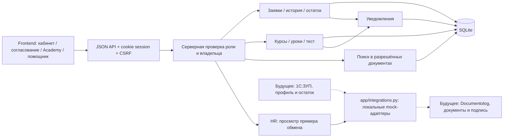
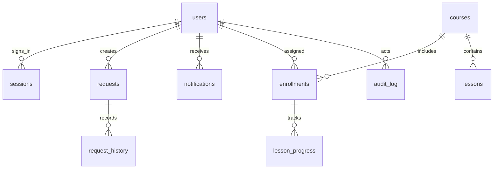

# Архитектура Qadam11

Текущая версия замыкает один сквозной HR-сценарий: вход → профиль → заявка на отпуск → решение руководителя → уведомление. Обучение и помощник используют ту же серверную сессию и права.

Пунктиром обозначены будущие промышленные подключения. Mock-адаптеры уже существуют и возвращают вымышленные примеры без сетевых вызовов и изменения SQLite. HR открывает их через /integrations, доступ к API проверяет сервер. Текущие источники профилей — локальные таблицы. По умолчанию внешняя модель выключена. При явном включении помощник отправляет вопрос и до четырёх разрешённых документов настроенному провайдеру (в текущем локальном показе — Gemini).

## Права

| Ресурс | Сотрудник | Руководитель | HR |
|---|---|---|---|
| Свой профиль | Чтение | Чтение | Чтение |
| Кадровые данные | Без редактирования | Без редактирования | Без редактирования через этот API |
| Свои заявки | Создать/посмотреть/отменить pending | То же | То же |
| Чужие заявки | Нет | Прямые подчинённые | Все сотрудники |
| Решение по заявке | Нет | Подчинённые, кроме себя | Все, кроме себя |
| Курсы и прогресс | Свои назначения | Свои назначения | Свои назначения |
| Назначение курса | Нет | Нет | Да |
| Уведомления | Только свои | Только свои | Только свои |
| База знаний | Общие статьи | Общие + памятка руководителя | Все учебные статьи |

Проверка работает в сервисном слое, поэтому скрытие кнопки в UI не является механизмом защиты. Чужой id возвращает 404 для ресурсов с ограниченным доступом. Запрос списка без нужной роли возвращает 403.

## Модель данных

Роль берётся из SQLite по серверной сессии, не из тела запроса. Пароли хешируются PBKDF2-HMAC-SHA256 с индивидуальной солью, 200 000 итераций. Сессионный токен хранится в базе в виде SHA256; исходное значение находится только в HttpOnly cookie браузера. Сессия действует 8 часов. CSRF-токен независим от значения cookie.

Решение по заявке выполняется в `BEGIN IMMEDIATE`: прочитать текущий статус → проверить права и остаток → списать дни → изменить статус → записать историю и уведомление → commit. Это исключает двойное списание при конкурентном одобрении. Ошибка откатывает всю транзакцию.

## Граница помощника

Сначала сервер выбирает опубликованные статьи, доступные текущей роли. Локальный режим использует нормализацию слов, осторожную коррекцию опечаток и BM25. Для ответа нужны все значимые слова вопроса в одном фрагменте (или заголовке с описанием). Ответ возвращает текст статьи, id, название и URL. Если подтверждения нет — found=false и предложение обратиться в HR.

Собственный остаток возвращается отдельно из авторизованного профиля, без вызова модели. Помощник не запрашивает профили других сотрудников.

При JANAMEN_AI_PROVIDER=openai и наличии OPENAI_API_KEY/OPENAI_MODEL подключается app/model.py: до четырёх кандидатов и вопрос отправляются в Responses API. Модель выбирает цитаты через строгую JSON-схему. Сервер проверяет принадлежность source_id разрешённым документам и дословное наличие цитаты; итог состоит только из этих цитат. При таймауте или неверной цитате используется локальный поиск с пояснением. Профиль, список сотрудников и ключ во frontend не передаются. Живой провайдер без ключа не проверен; тесты используют подставные ответы.

Лексический поиск может отказать на корректную новую формулировку. Проверка цитаты не гарантирует смысловой релевантности модели, поэтому необходима независимая оценка. Учебный набор и текущие результаты описаны в NURS_DONE.md.

Учебный контент импортируется через app/learning.py одной транзакцией. learning_imports связывает тип и slug с созданным id, поэтому повторный импорт не создаёт дубликаты. Назначения и прежний прогресс не изменяются импортом.

## Будущие интеграции

Дополнение: app/branches.py хранит проверенные публичные координаты в branches и привязки в employee_branches. GET карты и календаря фильтрует людей и отпуска по серверной сессии перед расчётом агрегатов. Leaflet загружается отдельным chunk только при открытии /branches; подложка OpenStreetMap не требует API-ключа. Привязки и пороги меняет только HR, с CSRF и audit_log. Минимум для всего филиала не применяется к частичной команде руководителя.

Gemini запускается явно через scripts/start_gemini.py. Локальный data/gemini.json не попадает в Git/ZIP и не доступен через HTTP. Если GEMINI_MODEL=auto, сервер получает список моделей через официальный models.list, выбирает стабильный текстовый Flash и кеширует выбор. Ключ передаётся заголовком; после генерации сохраняется прежняя проверка источников и цитат. При ошибке API помощник сообщает о локальном поиске.

**1С:ЗУП:** отдельный адаптер синхронизирует официальные поля профиля и остаток отпуска. UI остаётся read-only. Потребуются привязка внешнего идентификатора, дата синхронизации и обработка конфликтов. Сейчас адаптера нет.

**Documentolog:** после решения согласующего создаётся/обновляется документ во внешней системе, а внешний статус попадает в историю через защищённый webhook или синхронизацию. Для надёжной доставки нужен outbox и idempotency key. Сейчас документация обозначает этот путь, сетевые вызовы не моделируются как успешные.

**Корпоративный вход:** вместо демо-паролей — SSO/OIDC. Пользовательский API и проверка владельцев остаются теми же. Сейчас используется локальная cookie-сессия.

## Итоговое обновление адаптеров

Помощник поддерживает явно выбранные openai / gemini / chat. Конфигурация едина для статуса и вызова, имя модели задаётся явно. Один ключ не включает отправку данных. Gemini передаёт ключ заголовком, совместимый Chat endpoint допускает HTTPS. Настройки и границы — AI_CONFIGURATION.md.

Схема с будущими 1С:ЗУП и Documentolog также доступна в виде редактируемых объектов на слайде 5 презентации. В поставке нет успешных заглушек реальных внешних интеграций. Статусы и история текущих заявок принадлежат локальному прототипу.
